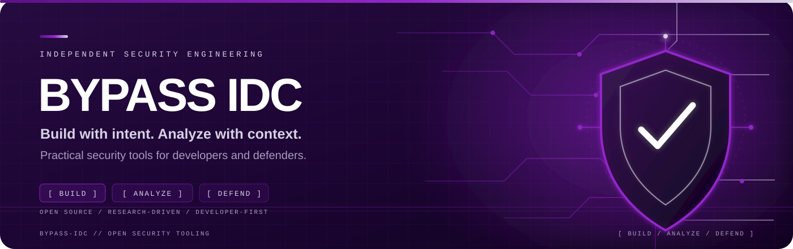
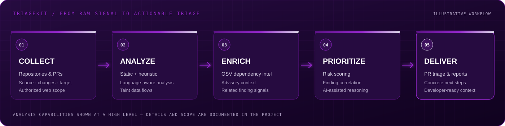
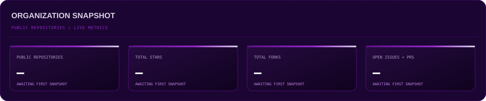
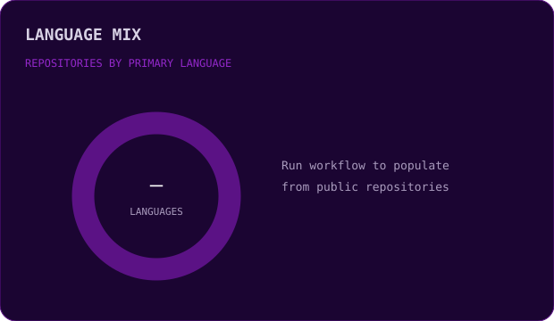
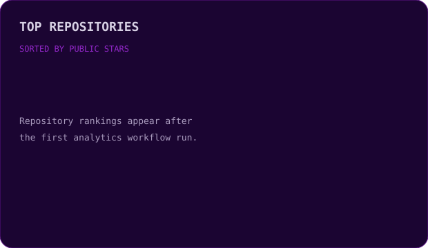
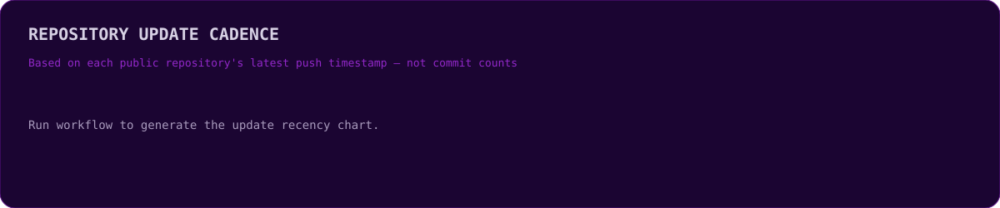

### BUILD WITH INTENT. ANALYZE WITH CONTEXT. DEFEND BY DESIGN.

**Open-source security tools built for developers, security engineers, and defenders.**

[Explore repositories](https://github.com/BYPASS-IDC?tab=repositories) &nbsp;·&nbsp;
[Discover TriageKit](https://github.com/orgs/BYPASS-IDC/repositories?q=TriageKit) &nbsp;·&nbsp;
[Report an issue](https://github.com/BYPASS-IDC/.github/issues)

---

## `01 / MISSION`

BYPASS IDC is an independent home for practical security engineering: tools that make application security more actionable, analysis more contextual, and secure development workflows easier to adopt.

We build and release security-focused software with an emphasis on **useful signal over noise**, transparent findings, and workflows developers can actually use.

<table>
<tr>
<td width="33%" valign="top">

**01 — BUILD**

Purpose-built tools that solve concrete security and engineering problems.

</td>
<td width="33%" valign="top">

**02 — ANALYZE**

Context-aware inspection, risk prioritization, and evidence-driven results.

</td>
<td width="33%" valign="top">

**03 — ENABLE**

Developer-friendly workflows, automation, and practical documentation.

</td>
</tr>
</table>

## `02 / FLAGSHIP PROJECT`

<table>
<tr>
<td width="58%" valign="top">

### TriageKit

**Security analysis that fits the development workflow.**

TriageKit brings multiple layers of security intelligence together to help teams investigate code, understand risk, and prioritize findings.

- Multi-stage static and heuristic analysis
- Language-aware taint analysis
- OSV-powered dependency intelligence
- Risk scoring and finding correlation
- AI-assisted security reasoning
- GitHub pull-request triage and repository scanning
- Authorized web assessment workflows

[**Explore TriageKit →**](https://github.com/orgs/BYPASS-IDC/repositories?q=TriageKit)

</td>
<td width="42%" valign="top">

</td>
</tr>
</table>

## `03 / ENGINEERING FOCUS`

<table>
<tr>
<td width="50%" valign="top">

### Application security
Code analysis, vulnerability discovery, security review, and actionable remediation context.

### Dependency intelligence
Open-source dependency risk, vulnerability metadata, and software supply-chain awareness.

</td>
<td width="50%" valign="top">

### Developer workflows
Pull-request feedback, repository scanning, automation, and CI-friendly integrations.

### Research & experimentation
Heuristics, language-aware analysis, finding correlation, and practical AI-assisted security.

</td>
</tr>
</table>

## `04 / ORGANIZATION TELEMETRY`

A live snapshot of BYPASS IDC's **public repositories**. Charts are generated from GitHub's API by this repository's GitHub Actions workflow.

<table>
<tr>
<td width="50%" valign="top">

</td>
<td width="50%" valign="top">

</td>
</tr>
</table>

Metrics include public repositories only. Language mix counts each repository's primary language. Update cadence groups repositories by their latest push date; it is not a commit or contribution count.

## `05 / TOOLING & TECHNOLOGY`

We choose technologies based on the problem each tool solves. The live language chart above reflects the primary languages actually used across public BYPASS IDC repositories; each project repository remains the source of truth for its dependencies and supported environments.

## `06 / CONTRIBUTE & COLLABORATE`

We value clear reports, reproducible research, thoughtful code review, and documentation that helps other people use the tools.

- Read the contribution and security policies in the target repository before submitting changes.
- Include concise reproduction steps, impact, and supporting evidence in bug reports.
- Disclose vulnerabilities privately through the reporting channel documented by the affected project.
- Only assess systems, applications, and infrastructure when you have explicit authorization.

## `07 / FIND US`

**Independent security engineering. Open tools. Better signal.**

Built with curiosity, tested with discipline, released responsibly.

